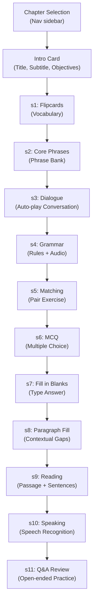

# 02 — Pedagogy and Learning Cycle

> **Source:** Reverse-engineered from `german-a2-html` and `danish-a1-html` Complete Mastery codebases
> **Tag:** `[VERIFIED FROM MASTERY CODEBASE]` (all details directly observed in live code)

---

## 1. Overall App Architecture

The "Complete A1 Master Learning App" (App #01) is a **chapter-based, multi-section, self-paced learning application** with:

- **Multiple chapters** (German A2 demo has 7; Danish A1 has 9; German A1 would have its own chapter set)
- **11 learning sections per chapter** (numbered s1–s11 in the codebase)
- **Progressive difficulty** within each chapter
- **Gamification** (XP, levels, streaks, daily goals) to maintain motivation
- **Bilingual support** (English + Bengali) throughout

## 2. Chapter Entry Flow

When a user opens or selects a chapter:

```
1. startChapterSession()   → updates streak, awards +5 XP
2. renderChapter()         → builds all 11 section cards
3. updateSectionUI()       → restores completion state from localStorage
4. buildNav()              → refreshes sidebar navigation
```

## 3. The 11 Learning Sections (Exact Order)

Each chapter renders these 11 sections in this exact order:

### Section 1 (s1): **Flipcards** — `sec-flash`
- **Purpose:** Vocabulary introduction via interactive flashcards
- **Data source:** `ch.cards[]` array
- **Card structure:** Front face (target language word/phrase) → Back face (EN + BN meaning + audio button)
- **Interaction:** Tap/click to flip card (CSS 3D transform with `rotateY(180deg)`)
- **Audio:** Each card has a 🔊 Audio button that calls `speakGerman(card.audio || card.front)`
- **Progress:** Each flip calls `addProgress(1)`
- **XP reward:** 6 XP on "Done Section"

### Section 2 (s2): **Core Phrases** — `sec-phrases`
- **Purpose:** Essential phrase bank for the chapter topic
- **Data source:** `ch.phrases[]` array
- **Display:** 2-column grid of phrase blocks
- **Each phrase shows:** German text (large, bold) → EN translation → BN translation → 🔊 German Audio button
- **Layout:** `.grid.cols-2` with `.block` containers
- **XP reward:** 6 XP on "Done Section"

### Section 3 (s3): **Dialogue** — `sec-dialogue`
- **Purpose:** Contextual conversation practice with auto-play
- **Data source:** `ch.chat[]` array (each item has `type: 'bot'|'user'`, `de`, `en`, `bn`)
- **Modes:**
  - **▶ Start Dialogue:** Lines appear one-by-one as chat bubbles with auto TTS (2600ms between lines)
  - **🔁 Repeat Mode:** Plays each line with 3200ms pause for learner to repeat aloud
  - **■ Stop:** Stops playback and clears all timers
- **Translation controls:** Show EN / Show BN / Hide Translation buttons
- **Speed controls:** 1x (default), 0.85x, 0.7x speed buttons
- **Visual:** Chat-style layout with `.bot` (white, left-aligned) and `.user` (dark gradient, right-aligned) bubbles
- **XP reward:** 7 XP on "Done Section"

### Section 4 (s4): **Grammar Section** — `sec-grammar`
- **Purpose:** Detailed grammar explanations with rich HTML
- **Data source:** `ch.grammar[]` array (each item has `title`, `html`, `audio[]`)
- **Display:** Grammar items with:
  - Title (`.grammar-title`)
  - Rich HTML content using semantic boxes: `.rulebox` (blue), `.structurebox` (dashed), `.examplebox` (green), `.mistakebox` (red), `.minibox` (yellow)
  - Tables for conjugation/declension patterns
  - Audio practice row: each audio sentence gets a 🔊 button
- **XP reward:** 10 XP on "Done Section" (highest section reward — grammar is prioritized)

### Section 5 (s5): **Matching Exercise** — `sec-match`
- **Purpose:** Associate German items with their English/translation equivalents
- **Data source:** `ch.match[]` array (each item has `left`, `right`)
- **Mechanics:** Two-column layout (`.match` grid) with:
  - Left column: German items (`.pair` elements)
  - Right column: English meanings (`.drop` elements)
  - Tap one from each side → system checks if `drop.dataset.pair === pair.dataset.val`
  - Correct: green highlight (`.good`) + 2 XP + `addProgress(2)`
  - Incorrect: red highlight (`.bad`)
- **Items are shuffled** independently on each column
- **XP reward:** 6 XP on "Done Section"

### Section 6 (s6): **MCQ Practice** — `sec-mcq`
- **Purpose:** Multiple-choice comprehension and grammar testing
- **Data source:** `ch.mcq[]` array (each has `q`, `opts[]`, `ans` (0-indexed), `en`, `bn`)
- **Mechanics:**
  - Question displayed with numbered prefix
  - 4 options as tappable `.opt` elements
  - Correct answer turns green (`.good`), incorrect turns red (`.bad`), correct answer always highlighted
  - Correct: `addProgress(2)` + 2 XP with reason "Correct MCQ"
- **Answer reveal:** "Show Answers (EN + BN)" / "Hide Answers" buttons — shows correct option + EN + BN explanation
- **XP reward:** 6 XP on "Done Section"

### Section 7 (s7): **Fill in the Blanks** — `sec-fill`
- **Purpose:** Active recall — type the missing German word
- **Data source:** `ch.fill[]` array (each has `q` with `____`, `ans[]`, `en`, `bn`)
- **Mechanics:**
  - Question with blank shown as `____`
  - Text input + Check button + 🔊 Audio button
  - Validation: `normalize(input.value)` compared against all items in `ans[]`
  - Feedback: ✅ Correct / ঠিক আছে OR ❌ Try again / আবার চেষ্টা করো
  - `normalize()` trims, lowercases, collapses whitespace, and strips diacritics (NFD + remove combining marks)
- **Answer reveal:** "Show Answers (EN + BN)" / "Hide Answers" — shows German answer + EN + BN explanation
- **XP reward:** 6 XP on "Done Section"

### Section 8 (s8): **Paragraph Fill in the Blanks** — `sec-paragraph`
- **Purpose:** Contextual gap-fill in a longer text passage
- **Data source:** `ch.paragraphFill` object with `text`, `answers[][]`, `enAnswers[]`, `bnAnswers[]`
- **Mechanics:**
  - Full paragraph displayed with `___` replaced by `<input>` fields
  - "Check All" button validates all gaps simultaneously
  - Each input border turns green (correct) or red (incorrect)
  - Overall feedback: ✅ All correct / সব ঠিক আছে OR ❌ Some answers need correction / কিছু উত্তর ঠিক করতে হবে
- **Audio:** 🔊 Paragraph Audio button reads the full text
- **Answer reveal:** Shows all German answers + EN explanations + BN explanations in numbered list
- **XP reward:** 7 XP on "Done Section"

### Section 9 (s9): **Reading Passage** — `sec-reading`
- **Purpose:** Extended reading comprehension with sentence-level audio
- **Data source:** `ch.reading` object with `text`, `en`, `bn`
- **Display:**
  - Full passage in large text (`.read-text`, 18px, font-weight 800)
  - 🔊 Full Reading Audio button (reads entire passage)
  - Show EN / Show BN / Hide Translation toggle buttons
  - **Sentence-by-sentence playback:** Text is split on `. ` and each sentence gets its own 🔊 button
- **Translation:** Hidden by default, revealed in `.reveal-box` containers
- **XP reward:** 8 XP on "Done Section"

### Section 10 (s10): **Speaking Practice** — `sec-speak`
- **Purpose:** Pronunciation practice with speech recognition scoring
- **Data source:** `ch.speakingPractice[]` array (simple string list of German sentences)
- **Mechanics:**
  - Each sentence displayed with:
    - 🔊 Listen button → `speakGerman(line)` for model pronunciation
    - 🎤 Speak button → `startSpeechPractice(line, outId)` using Web Speech Recognition API
  - SpeechRecognition config: `lang='de-DE'`, `interimResults=false`, `maxAlternatives=1`
  - **Scoring:** Word-level matching — counts matching words between reference and heard text
  - **Score formula:** `Math.round((matches / refWords.length) * 100)`
  - **Pass threshold:** Score ≥ 60% OR exact match
  - **Feedback:** "Target: ..., You said: ..., Match score: N%, ✅ Good job / ভালো হয়েছে" or "❌ Try again / আবার চেষ্টা করো"
  - **XP reward:** 6 XP per successful speaking attempt (reason: 'Speaking practice')
- **XP reward:** 8 XP on "Done Section"

### Section 11 (s11): **Question and Answer Practice** — (no toggle, always visible)
- **Purpose:** Open-ended Q&A practice with model answers
- **Data source:** `ch.qa[]` array (each has `q`, `en`, `bn`, `answer`)
- **Display:**
  - Question in German (`.qa-q`)
  - 🔊 Question Audio button
  - Show EN / Show BN / Hide Translation toggle buttons
  - Show Answer button → reveals model answer in `.qa-answer` box
- **Translation toggling:** Per-question EN/BN toggle (independent, not global)
- **Note:** This section does NOT have a "Done Section" button — it's the final review

## 4. Section Completion Tracking

- Each section (except s11) has a "Done Section" button and a status text
- `markSectionDone(sectionId, reward)`:
  - Stores `localStorage[key] = '1'` where key = `{prefix}_{chapterId}_{sectionId}`
  - Calls `incrementDailyGoal()`
  - Awards XP (`addXP(reward, 'Section completed')`)
  - Updates UI: border turns green, status shows "✅ Section done", button disables
- `updateSectionUI()` restores state on chapter load
- Section completion persists across page refreshes via localStorage

## 5. Study Guide (Sidebar Feature)

- Located in the left sidebar navigation
- Toggle buttons: "EN Guide" / "BN Guide" / "Hide"
- `toggleStudyGuide(mode)`: Shows/hides study guide content in EN or BN
- Uses `#study-en` and `#study-bn` DOM elements
- Provides chapter-level learning tips and study strategy in both languages

## 6. Learning Path Summary


