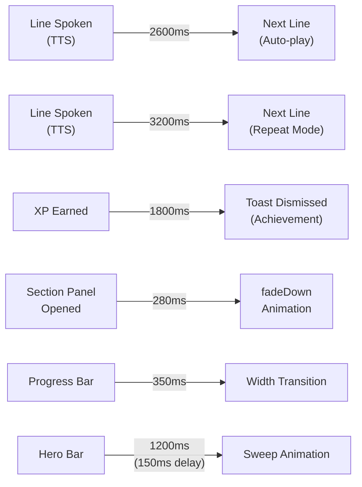

# 03 — Audio, TTS, and Timing Engine

> **Source:** Reverse-engineered from `german-a2-html` Complete Mastery codebase
> **Tag:** `[VERIFIED FROM MASTERY CODEBASE]`

---

## 1. Web Speech API — Text-to-Speech (TTS)

### Core speak() Function

```javascript
function speak(text, lang='de-DE', onEnd=null) {
  if (!('speechSynthesis' in window)) return;
  const u = new SpeechSynthesisUtterance(
    String(text || '').replace(/<[^>]*>/g, '')  // strip HTML tags
  );
  u.lang = lang;
  const v = getGermanVoice();
  if (v) u.voice = v;
  u.rate = globalRate;
  u.pitch = 1;
  u.volume = 1;
  if (onEnd) u.onend = onEnd;
  speechSynthesis.speak(u);
}
```

### Key Properties:

| Property | Value | Notes |
|---|---|---|
| `lang` | `'de-DE'` | German (Germany) locale |
| `rate` | `globalRate` (default 1) | Adjustable via speed controls |
| `pitch` | `1` | Fixed, natural pitch |
| `volume` | `1` | Maximum volume |

### HTML Tag Stripping:
Input text is cleaned with `String(text).replace(/<[^>]*>/g, '')` before speaking — prevents TTS from reading HTML tags aloud.

### Convenience Wrapper:

```javascript
function speakGerman(text) {
  speak(text, 'de-DE');
}
```

## 2. Voice Selection

### Voice Loading:

```javascript
let DE_VOICES = [];

function loadVoices() {
  try { DE_VOICES = speechSynthesis.getVoices(); } catch(e) {}
}
```

- `loadVoices()` is called during initialization
- `speechSynthesis.onvoiceschanged` likely triggers re-loading (browser-dependent)

### Voice Priority (`getGermanVoice()`):

```javascript
function getGermanVoice() {
  return (DE_VOICES || []).find(v => (v.lang || '').toLowerCase() === 'de-de')
      || (DE_VOICES || []).find(v => (v.lang || '').toLowerCase().startsWith('de'))
      || null;
}
```

**Priority order:**
1. **Exact match:** voice with `lang === 'de-de'` (case-insensitive)
2. **Prefix match:** voice with `lang` starting with `'de'` (e.g., `de-AT`, `de-CH`)
3. **Fallback:** `null` (uses browser default for the specified `lang`)

## 3. Speed Control System

### Speed Buttons:

| Button | Rate Value | CSS |
|---|---|---|
| **1x** (default) | `1` | `.speed-btn.active` |
| **0.85x** | `0.85` | `.speed-btn` |
| **0.7x** | `0.7` | `.speed-btn` |

### setSpeed() Implementation:

```javascript
let globalRate = 1;

function setSpeed(rate) {
  globalRate = rate;
  document.querySelectorAll('.speed-btn').forEach(btn => {
    btn.classList.toggle('active', Number(btn.dataset.rate) === rate);
  });
}
```

- `globalRate` is a module-level variable shared by all TTS calls
- Active button gets `.active` class (outlined highlight)
- Speed change applies immediately to next `speak()` call

## 4. Dialogue Auto-Play Timing

### Constants:

| Constant | Value | Purpose |
|---|---|---|
| `dialogueTimer` delay | **2600 ms** | Gap between auto-played dialogue lines |
| Repeat mode pause | **3200 ms** | Pause after each line in repeat mode (time for learner to repeat) |
| Achievement popup | **1800 ms** | Duration achievement toast stays visible |

### Dialogue State Variables:

```javascript
let DE_VOICES = [];
let dialoguePlayTimers = [];    // Array of setTimeout IDs for repeat mode
let speakModeStopped = false;   // Flag to stop repeat mode
let globalRate = 1;             // TTS speed multiplier
let dialogueIndex = 0;          // Current line index in dialogue
let dialogueRunning = false;    // Whether dialogue is actively playing
let dialogueTimer;              // Current setTimeout ID for next line
```

### Auto-Play Flow (`startDialogue()` → `showNextDialogueLine()`):

```javascript
function startDialogue() {
  const ch = getCurrentChapter();
  const box = document.getElementById('dialogue-box');
  if (!ch || !ch.chat || !box) return;
  stopDialogue();
  box.innerHTML = '';
  dialogueIndex = 0;
  dialogueRunning = true;
  const status = document.getElementById('repeat-status');
  if (status) status.textContent = 'Dialogue started. Lines will appear one by one.';
  showNextDialogueLine();
}

function showNextDialogueLine() {
  const ch = getCurrentChapter();
  const box = document.getElementById('dialogue-box');
  if (!dialogueRunning || !ch || !box) return;
  if (dialogueIndex >= ch.chat.length) {
    dialogueRunning = false;
    const status = document.getElementById('repeat-status');
    if (status) status.textContent = '✅ Dialogue finished.';
    return;
  }
  const line = ch.chat[dialogueIndex];
  // Create bubble element with German text + EN/BN translations
  // Append to dialogue-box, scroll to bottom
  speakGerman(line.de);
  dialogueIndex++;
  dialogueTimer = setTimeout(showNextDialogueLine, 2600);
}
```

**Flow sequence:**
1. `startDialogue()` — calls `stopDialogue()`, resets state, calls `showNextDialogueLine()`
2. `showNextDialogueLine()` — creates `.bubble` DOM element, speaks German text, schedules next line after 2600ms
3. Each bubble includes EN + BN translation divs (visibility based on `APP.trMode`)
4. Auto-scrolls `#dialogue-box` to bottom after each new bubble

### Repeat Mode Flow (`startRepeatMode()`):

```javascript
function startRepeatMode(chatArr, statusId) {
  if (!('speechSynthesis' in window) || !Array.isArray(chatArr) || !chatArr.length) return;
  stopDialogue();
  speakModeStopped = false;
  let i = 0;
  const status = document.getElementById(statusId);

  function next() {
    if (speakModeStopped) return;
    if (i >= chatArr.length) {
      if (status) status.textContent = '✅ Repeat mode finished. / রিপিট মোড শেষ।';
      return;
    }
    const current = chatArr[i];
    if (status) {
      status.textContent =
        '🎤 Listen carefully...\n' + current.de + '\n\n' +
        'Now repeat aloud after the pause. / এখন বিরতির পরে জোরে বলো।';
    }
    const utter = new SpeechSynthesisUtterance(String(current.de || '').replace(/<[^>]*>/g, ''));
    utter.lang = 'de-DE';
    const v = getGermanVoice();
    if (v) utter.voice = v;
    utter.rate = globalRate;
    utter.pitch = 1;
    utter.volume = 1;
    utter.onend = () => {
      if (speakModeStopped) return;
      const timer = setTimeout(() => { i++; next(); }, 3200);
      dialoguePlayTimers.push(timer);
    };
    speechSynthesis.speak(utter);
  }
  next();
}
```

**Key details:**
- Displays status: "🎤 Listen carefully... [German text]... Now repeat aloud after the pause."
- After TTS finishes speaking, waits **3200ms** for learner to repeat, then advances
- Uses `speakModeStopped` flag to allow early termination

### Stop Controls:

```javascript
function stopSpeak() {
  if ('speechSynthesis' in window) speechSynthesis.cancel();
}

function stopDialogue() {
  dialogueRunning = false;
  speakModeStopped = true;
  clearTimeout(dialogueTimer);
  clearDialogueSequenceTimers();
  stopSpeak();
}

function clearDialogueSequenceTimers() {
  dialoguePlayTimers.forEach(t => clearTimeout(t));
  dialoguePlayTimers = [];
}
```

## 5. Speech Recognition (Speaking Practice)

### Configuration:

```javascript
function startSpeechPractice(text, outId) {
  const out = document.getElementById(outId);
  const SR = window.SpeechRecognition || window.webkitSpeechRecognition;
  if (!SR) {
    if (out) out.textContent = 'Speech recognition is not supported on this browser. / এই ব্রাউজারে speech recognition নেই।';
    return;
  }
  const rec = new SR();
  rec.lang = 'de-DE';
  rec.interimResults = false;
  rec.maxAlternatives = 1;
  if (out) {
    out.textContent = '🎤 Listening... Say the sentence clearly.\nবলুন।';
  }
  // ...
}
```

| Property | Value | Notes |
|---|---|---|
| `lang` | `'de-DE'` | German recognition locale |
| `interimResults` | `false` | Only final results (no partial) |
| `maxAlternatives` | `1` | Single best result |

### Scoring Algorithm:

```javascript
rec.onresult = (e) => {
  const heard = e.results?.[0]?.[0]?.transcript || '';
  const ref = normalize(text);
  const got = normalize(heard);
  
  const refWords = ref.split(' ').filter(Boolean);
  const gotWords = got.split(' ').filter(Boolean);
  const matches = gotWords.filter(w => refWords.includes(w)).length;
  score = Math.round((matches / Math.max(1, refWords.length)) * 100);
  
  const ok = score >= 60 || got === ref;

  if (out) {
    out.textContent =
      'Target: ' + text + '\n' +
      'You said: ' + heard + '\n' +
      'Match score: ' + score + '%\n' +
      (ok ? '✅ Good job / ভালো হয়েছে' : '❌ Try again / আবার চেষ্টা করো');
  }
  if (ok) addXP(6, 'Speaking practice');
};

rec.onerror = () => {
  if (out) out.textContent = 'Speech recognition could not start. Please allow microphone access. / মাইক্রোফোন অনুমতি দিন।';
};
rec.start();
```

**Key details:**
- Both reference and heard text are normalized (lowercase, trim, collapse spaces, strip diacritics via NFD)
- **Word-level matching:** counts how many spoken words appear in the reference
- **Pass threshold: 60%** word match OR exact string match
- Successful attempt awards **6 XP** (reason: 'Speaking practice')

### Normalization Function:

```javascript
function normalize(s) {
  return String(s || '')
    .trim()
    .toLowerCase()
    .replace(/\s+/g, ' ')
    .normalize('NFD')
    .replace(/[\u0300-\u036f]/g, '');
}
```

This strips all combining diacritical marks after NFD decomposition — important for German characters like ä, ö, ü.

> [!NOTE]
> `ß` does NOT decompose via NFD, so "straße" and "strasse" would NOT be treated as equivalent by this function. This is a potential edge case in the scoring.

## 6. iframe postMessage Protocol

```javascript
// Script block 3 (136 chars):
window.addEventListener("message", e => {
  if (e.data?.type === "shield-stop") stopDialogue()
});
window.addEventListener("pagehide", stopDialogue);
```

- Parent page sends `{ type: "shield-stop" }` message to stop all audio when:
  - User switches to a different demo app
  - User navigates away from the page
- `pagehide` event also triggers `stopDialogue()` for cleanup

## 7. Dialogue Translation Toggle

```javascript
function toggleDialogueTranslation(mode) {
  APP.trMode = mode;
  document.querySelectorAll('#dialogue-box .tr-en').forEach(n => {
    n.style.display = mode === 'en' ? 'block' : 'none';
  });
  document.querySelectorAll('#dialogue-box .tr-bn').forEach(n => {
    n.style.display = mode === 'bn' ? 'block' : 'none';
  });
  if (mode === 'hide') {
    document.querySelectorAll('#dialogue-box .tr-en, #dialogue-box .tr-bn').forEach(n => {
      n.style.display = 'none';
    });
  }
}
```

- **Global setting** that affects all visible and future dialogue bubbles
- Stored in `APP.trMode` and used when creating new bubbles in `showNextDialogueLine()`
- Three modes: `'en'` (show English), `'bn'` (show Bengali), `'hide'` (hide both)

## 8. Complete Timing Summary


